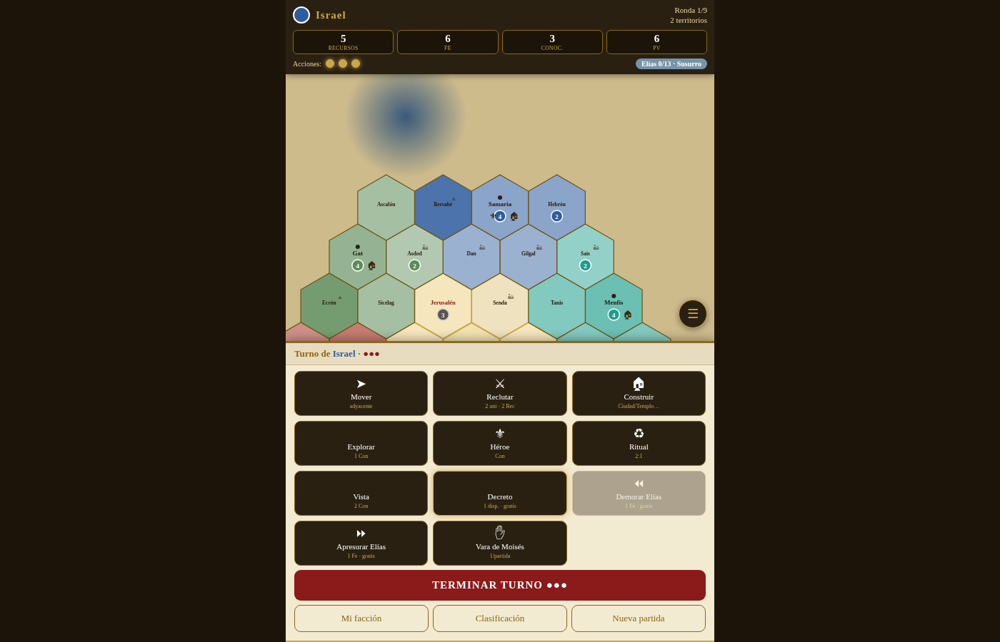

# Crónicas del Pacto Eterno

Juego de mesa de estrategia (4-6 jugadores, 60-90 min) ambientado en el Cercano Oriente antiguo, con **prototipo digital jugable** de un solo archivo HTML: funciona en el navegador, sin instalar nada, con oponentes IA y modo hotseat.

## Jugar ahora

**Demo jugable:** https://andrescampomar2010-dotcom.github.io/cronicas-del-pacto-eterno/

## Qué hay en este repositorio

- `index.html` — el prototipo completo: mapa hexagonal de 37 territorios, 6 pueblos asimétricos (Israel, Egipto, Babilonia, Asiria, Filistea y Persia), cartas de la Voz con Milagros y Plagas, tácticas, decretos, reliquias, maravillas y el Arca. Mecánicas anti-líder: los milagros ayudan a quien va último y las plagas golpean a quien va primero.
- `REGLAS-RESUMEN.md` y `REGLAMENTO-RESUMEN.pdf` — una **versión parcial** del reglamento: la idea, el tablero, los recursos, el turno y cómo se gana. No incluye la tabla de costes, el combate detallado, la puntuación completa, los pueblos en detalle ni los textos de las cartas.

## ¿Interesado?

El reglamento completo no es público. Si te interesa el juego — probarlo a fondo, playtest, edición o cualquier propuesta — escribe a **andrescampomar2010@gmail.com**.

## Licencia

© 2026 Andrés Campomar. Todos los derechos reservados. El prototipo se publica para que pueda jugarse y evaluarse; no se concede permiso para copiarlo, redistribuirlo ni crear obras derivadas.
